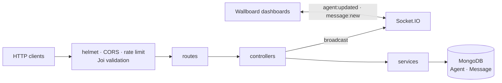

# Agent Wallboard API — Real-time Call Center Backend

**Backend for a call-center wallboard: agents log in and change status (Available, Active, Wrap Up, Not Ready), supervisors send messages, and every change is pushed to connected dashboards over WebSockets. Data lives in MongoDB.**


[](https://github.com/tawan230666/engse203-lab6-database-integration/actions/workflows/ci.yml)

> **ENGSE203 Computer Programming for Software Engineers, Lab 6 (Database Integration).** This is Phase 2 of the Agent Wallboard case study. Phase 1 (in-memory API): [agent-wallboard-learn](https://github.com/tawan230666/agent-wallboard-learn).

## Architecture



**Design choices**

- **Layered:** routes → controllers (HTTP) → services (business rules) → Mongoose models. Controllers never touch the database directly.
- **App separate from server:** `app.js` builds the Express app and `server.js` adds the HTTP server, Socket.IO, the database connection and graceful shutdown (SIGTERM/SIGINT). Tests import the app without opening ports.
- **Real-time:** every login, logout, status change and new message is broadcast, so wallboards update without polling.
- **Safe errors:** expected errors carry a status code (400/404); unexpected ones return a generic 500 without leaking internals.
- **Hardening:** `helmet` security headers, configurable CORS origins, rate limiting, and Joi validation that reports every problem at once and strips unknown fields.

## Run it

Requires Node.js 20+ and MongoDB (local, or a free MongoDB Atlas cluster).

```bash
git clone https://github.com/tawan230666/engse203-lab6-database-integration.git
cd engse203-lab6-database-integration/agent-wallboard-backend
cp .env.example .env        # set DATABASE_URL
npm install
npm run dev                 # http://localhost:3001
npm test                    # 13 API tests, no database needed
```

Import [`docs/Postman_Collection.json`](docs/Postman_Collection.json) to try every endpoint.

## API

| Method | Endpoint | Description |
|---|---|---|
| `GET` | `/api/agents` | All agents |
| `GET` | `/api/agents/:agentId` | One agent |
| `POST` | `/api/agents/:agentId/login` | Log in (creates the agent on first login) |
| `POST` | `/api/agents/:agentId/logout` | Log out (status becomes *Not Ready*) |
| `PATCH` | `/api/agents/:agentId/status` | Change status; validated against the allowed states |
| `POST` | `/api/messages` | Send a message to one agent (`to`) or to everyone (`to: null`) |
| `GET` | `/api/messages/agent/:agentId` | Agent inbox (direct + broadcast) with unread count |
| `PUT` | `/api/messages/:id/read` | Mark a message as read |
| `GET` | `/health` | Uptime and database connection status (503 when the DB is down) |

**Socket.IO events:** `agent:updated` (agent object), `message:new` (message object).

## Tests

`tests/` uses **Jest + Supertest** against the real Express app with the service layer mocked. The suite covers success paths, `400`/`404`/`500` mapping, Joi validation, unknown-field stripping and the WebSocket broadcasts. CI runs it on every push.

## Project structure

```
agent-wallboard-backend/
  app.js            Express app (middleware, routes, error handling)
  server.js         HTTP + Socket.IO server, DB connection, graceful shutdown
  routes/           agents.js, messages.js
  controllers/      HTTP layer
  services/         Business rules and data access
  models/           Mongoose schemas: Agent, Message
  middleware/       Joi validation, error handler
  utils/            winston logger, socket broadcast helper
  tests/            Jest + Supertest
docs/               Lab notes (Thai) and Postman collection
```

---

**Author:** Tawan Tiphkun (ธาวัน ทิพคุณ), [@tawan230666](https://github.com/tawan230666), Software Engineering, RMUTL Chiang Mai
